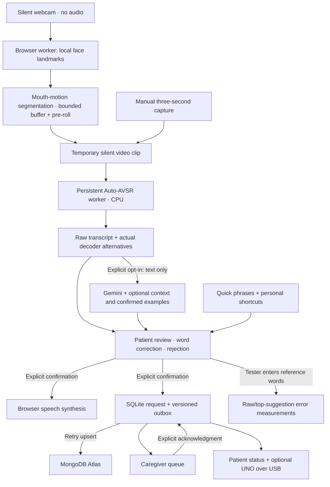

# Architecture

The gate detects movement, not meaning. It does not stream words or determine a
patient's intent. One phrase is processed at a time, capture pauses for review,
and the patient has to confirm before speech or request creation. Background tabs
pause automatic capture. Stop/cancel invalidates stale client results; model
cancellation terminates its process group so retries do not wait on orphan jobs.

The model owner is `model_worker.py`. The web server remains independent of
PyTorch and communicates with a Python 3.11 subprocess using bounded JSON lines.
The worker loads weights once, normalizes temporary clips to 25 fps, tracks/crops
the face with upstream code, and obtains actual beam-search hypotheses.

SQLite migrations use CREATE TABLE IF NOT EXISTS, retaining existing local data.
The cloud outbox stores the latest version of each request. A successful write
only removes the matching version: a newer acknowledgment cannot be accidentally
cleared by an older in-flight sync. Cloud failures never imply acknowledgment.

The only routine cloud payload to Gemini is text explicitly enabled by the user.
Atlas mirrors confirmed request text/status. Model weights, runtime assets,
credentials, local databases, and recordings are excluded from the Git repository.
No patient training dataset or production clinical accuracy is claimed.
